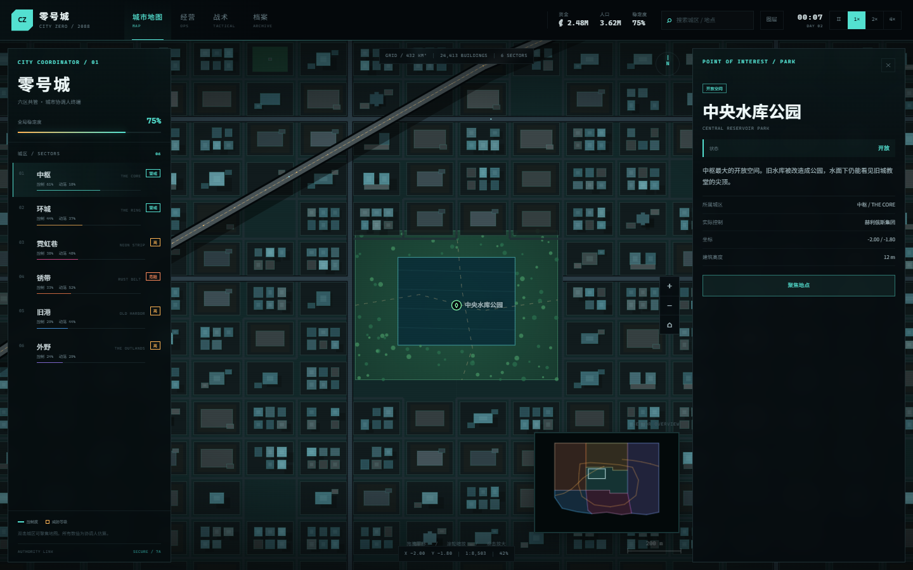

# 零号城 / CITY ZERO

一座 24 × 18 公里（约 432 平方公里）的程序化赛博都市，以及围绕它展开的城市运营 / 模拟 / 战术原型。




## 当前版本

这是一个可交互的 **城市级大地图 + 经营模拟原型**，不是静态概念页。

- **超大地图**：24 × 18 km，六个城区，约 24,400 栋程序化建筑
- **自由缩放**：滚轮 / 双指缩放、拖拽平移、双击放大、缩放按钮、小地图定位
- **地图 LOD**：远看是城市街区与路网，近看显示独立建筑、屋顶设备、天线与霓虹描边
- **建筑可视化**：高度着色、阴影、2.5D 挤出、屋顶细节、悬停查看建筑高度
- **六区**：中枢、环城、霓虹巷、锈带、旧港、外野
- **16 个兴趣点**：赫利俄斯塔、零号空港、潮汐宫、旧港集装箱场等
- **图层控制**：城区边界、兴趣点、车流、坐标网格
- **搜索**：按城区或地点搜索并聚焦
- **经营**：六区税率、治安预算、基建预算、日结算
- **模拟**：日期 / 时间推进、暂停 / 1× / 2× / 4× 速度
- **战术**：事件列表、行动单位、战术选择、成功率结算、城区控制度与威胁变化
- **档案**：城区、势力与城市历史

## 地图尺度

地图世界坐标为 24,000 × 18,000 米，包含城区、港口、工业带、荒原与空港。初始视图为全城尺度，放大后可看到建筑体块和屋顶细节。

地图为虚构城市，建筑、道路、地名和势力均为程序化生成或原创设定。

## 本地开发

```bash
npm install
npm run dev      # http://localhost:5188/city-zero/
npm run build
npm run preview
```

要求 Node.js 20+。

## 结构

```text
src/
├─ App.jsx                 游戏外壳、状态、经营与战术逻辑
├─ styles.css              HUD / 面板 / 移动端样式
├─ data/
│  └─ city.js              世界、六区、兴趣点、势力、事件、战术
├─ map/
│  ├─ generator.js         程序化城市生成 + 空间索引
│  ├─ renderer.js          Canvas 地图渲染、LOD、2.5D 建筑
│  └─ MapCanvas.jsx        缩放 / 平移 / 点选 / 小地图
└─ components/
   ├─ TopBar.jsx
   ├─ DistrictRail.jsx
   ├─ DistrictInspector.jsx
   └─ CommandPanels.jsx
```

## 性能

- 建筑按 600m 网格建立空间索引，只查询视口内建筑
- 远景聚合为街区体块，近景才绘制单体建筑
- 楼体绘制使用屏幕空间多边形，避免逐建筑 Canvas transform
- 车流只在 18% 以上缩放显示
- 1920×1080 桌面端与 390px 手机端均无横向溢出

## 下一步

- 将城区经济接入更完整的产业链与人口流动
- 让战术行动影响地图上的实际街区状态
- 增加建筑所有权、租金、治安热度与帮派地盘
- 增加剧情事件与城市派系任务线
- 支持存档、读档与城市种子

## 说明

本项目为原创虚构作品。地图中的城市、建筑、组织与事件均不代表现实地点或实体。
