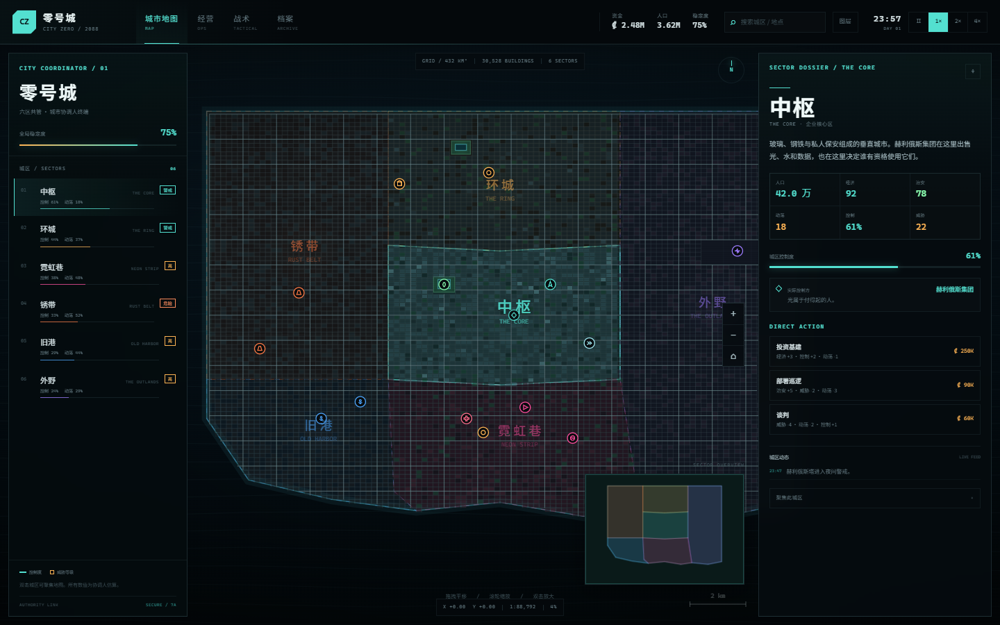

# 纽约 / NEW YORK CITY

真实纽约五区数据 + 城市运营 / 模拟 / 战术原型。



## 当前版本

- **全五区**：曼哈顿、布鲁克林、皇后区、布朗克斯、斯塔滕岛
- **778 km²** 真实陆地
- **1,082,349 栋** NYC 建筑总量（按视口流式加载）
- **262 个真实社区边界**（Neighborhood Tabulation Areas）
- **5,890 段主要街道**静态加载，普通街道独立按视口流式加载
- **763 个主要公园 / 开放空间**
- 建筑来自 NYC Open Data 真实轮廓，带 BIN / BBL / 建造年份 / 层数 / 屋顶高度
- 地标坐标真实：帝国大厦、时报广场、世贸中心、中央公园、布鲁克林大桥、洋基体育场、法拉盛草原等

## 视口流式加载

不再一次性加载整座城市的建筑：

1. 五区边界、社区边界、主要道路、公园、地标先加载
2. 地图缩放超过阈值后，按 **500m × 500m 瓦片**请求当前视口
3. 建筑瓦片和道路瓦片分别请求，互不依赖
4. 内存缓存，最多保留 140 个瓦片
5. 缩放/拖动时只补缺失瓦片，不重复请求
6. 低缩放级别不加载单体建筑，只显示五区、社区、主要路网和公园

建筑和道路的请求直接走 NYC 官方 ArcGIS 服务：

`https://a841-dotweb01.nyc.gov/arcgis/rest/services/GAZETTEER/NYCDOTBaseMap_Street/MapServer`

## 数据来源

- [NYC Building Footprints](https://data.cityofnewyork.us/City-Government/BUILDING/5zhs-2jue)
- [NYC Street Centerline (LION)](https://data.cityofnewyork.us/City-Government/Centerline/inkn-q76z)
- [NYC Borough Boundaries](https://data.cityofnewyork.us/City-Government/Borough-Boundaries/gthc-hcne)
- [NYC Neighborhood Tabulation Areas 2020](https://a841-dotweb01.nyc.gov/arcgis/rest/services/GAZETTEER/Neighborhood_Tabulation_Areas_2020/MapServer)
- NYC DOT Base Map / Parks & Open Space

五区范围：`-74.27, 40.49, -73.69, 40.92`（WGS84），访问时间 2026-11-18。

建筑高度优先使用 `HEIGHT_ROOF`（英尺 → 米），缺失时用 `NUM_FLOORS × 3.2m`。材质根据建造年份和高度推断，不是官方分类。

游戏城区、势力、事件和经营数值是虚构覆盖层。

## 功能

- **全五区地图**：真实海岸线、河流、岛屿、行政区与社区边界
- **真实社区边界**：NTA 虚线边界与社区名称
- **视口建筑流**：缩放后逐块出现真实建筑
- **LOD**：远景五区/社区/主要路网，中景流式建筑，近景独立建筑轮廓与屋顶
- **五区**：曼哈顿、布鲁克林、皇后区、布朗克斯、斯塔滕岛
- **搜索**：按城区或地标搜索并聚焦
- **经营**：五区税率、治安预算、基建预算、日结算
- **模拟**：日期 / 时间推进、暂停 / 1× / 2× / 4×
- **战术**：事件列表、行动单位、战术选择、成功率、控制度与威胁变化
- **档案**：城区、势力与城市历史

## 本地开发

```bash
npm install
npm run dev      # http://localhost:5188/city-zero/
npm run build
npm run preview
```

要求 Node.js 20+。

## 数据管线

```bash
node tools/fetch-nyc-all.mjs   # 拉取五区边界、主要道路、主要公园、NTA 社区
node tools/build-nyc-all.mjs   # 投影、简化、生成 src/data/nyc-map.json
```

建筑和普通街道不下载入库，由浏览器按视口实时请求。

## 结构

```text
src/
├─ App.jsx                 游戏外壳、状态、经营与战术
├─ styles.css              HUD / 面板 / 移动端
├─ data/
│  ├─ city.js              对外数据入口、势力、事件、战术
│  ├─ nyc.js               真实地图数据入口
│  ├─ nyc-map.json         五区、社区、主要道路、公园、地标
│  └─ nyc-district-meta.json
├─ map/
│  ├─ generator.js         静态图层 + 建筑空间索引 + 流式建筑标准化
│  ├─ stream.js            500m 瓦片请求与投影
│  ├─ renderer.js          Canvas 地图、真实多边形建筑、社区、街名
│  └─ MapCanvas.jsx        相机 / 交互 / 视口流式加载
└─ components/
   ├─ TopBar.jsx
   ├─ DistrictRail.jsx
   ├─ DistrictInspector.jsx
   └─ CommandPanels.jsx
```

## 性能

- 拖动/滚轮时使用画面快照做位图平移缩放，停手后才完整重绘
- 拖拽期间暂停建筑与道路瓦片请求
- 低缩放建筑使用包围盒 LOD，近景才使用真实多边形和 2.5D
- 建筑阴影仅在近景绘制
- 道路瓦片合并后抽稀到 8m 节点
- 渲染限制约 30fps，DPR 上限 1.5
- 瓦片索引重建做 90ms 合并
- 实测：中景约 90fps，拖拽约 70fps，近景约 75fps（1440×900 headless）
- 首屏只加载约 2.4MB 的静态底图
- 建筑不进入首屏 bundle
- 视口瓦片缓存，最多 140 个
- 建筑按 500m 网格建立空间索引
- 低缩放不加载单体建筑
- 真实街名只在 1.0 以上缩放显示

## 说明

建筑、街道、社区、公园几何来自纽约市公开数据；游戏城区、经营数值、事件和势力为虚构创作。
